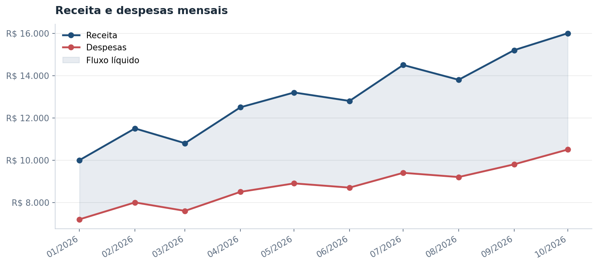
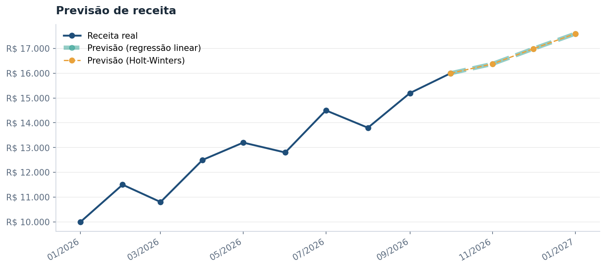
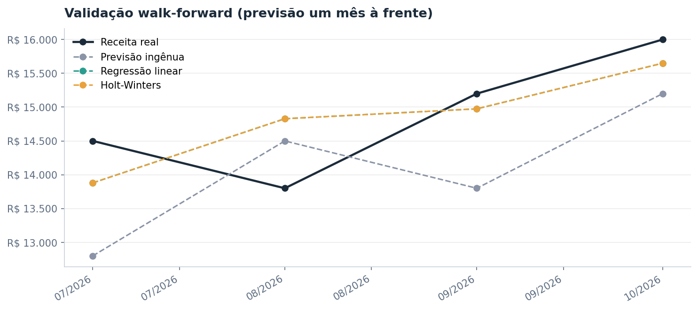

# Lab Financeiro

Aplicativo de análise quantitativa de fluxo de caixa: indicadores financeiros, estatística, regressão e séries temporais, com previsão de receita validada contra um modelo de referência.


Projeto desenvolvido em parceria entre um estudante de Engenharia de Software e um estudante de Contabilidade, com **dados reais autorizados e anonimizados**.

## Problema

[PREENCHER: 2 a 4 linhas sobre o problema de negócio, escritas com o colega de Contabilidade. Use o mesmo texto da seção 1 de `reports/metodologia.md`.]

A pergunta central é: **dá para prever a receita dos próximos meses com um modelo que realmente erra menos do que simplesmente repetir o último mês?** Por isso toda previsão é comparada com uma previsão ingênua, e só é considerada útil se vencer essa referência.

## Funcionalidades

- Carregamento de planilhas CSV e XLSX, com detecção automática de separador e codificação, e padronização dos nomes das colunas.
- Validação dos dados antes da análise (colunas obrigatórias, datas duplicadas, valores negativos, quantidade mínima de registros).
- Indicadores financeiros: fluxo líquido, margem líquida, variação mensal e crescimento da receita.
- Estatística: médias móveis, correlação de Pearson, tendência da receita por regressão linear (OLS) com p-valor e teste de normalidade de Shapiro-Wilk.
- Séries temporais: teste de estacionariedade (ADF), decomposição sazonal e suavização exponencial (Holt-Winters).
- Previsão de receita com validação **walk-forward** e as métricas MAE, RMSE e MAPE.
- Exportação dos resultados em CSV e Excel e relatório gerencial.

## Resultados com dados de exemplo

As imagens abaixo foram geradas com o conjunto **fictício** de `data/sample/`. Os dados reais não são publicados.







## Como executar

Pré-requisito: Python instalado. O projeto foi testado em Python 3.14.

```powershell
git clone https://github.com/gabrielcumino-commits/lab-financeiro.git
cd lab-financeiro

py -m venv .venv
.venv\Scripts\Activate.ps1

py -m pip install -r requirements.txt
```

Em macOS ou Linux, troque `py` por `python3` e ative o ambiente com `source .venv/bin/activate`.

| Objetivo | Comando |
|---|---|
| Abrir o aplicativo | `py -m streamlit run app.py` |
| Rodar os testes | `py -m pytest -q` |
| Gerar as figuras do README | `py -m scripts.gerar_figuras` |

Ao abrir o aplicativo sem enviar arquivo, ele usa os dados de exemplo.

## Formato dos dados

Um arquivo CSV ou XLSX com uma linha por mês e estas colunas:

| Coluna | Descrição |
|---|---|
| `data` | primeiro dia do mês, por exemplo `2026-01-01` |
| `receita` | receita do mês, em R$ |
| `despesas` | despesas do mês, em R$ |

Nomes alternativos comuns, como `mês`, `faturamento` e `custos`, são reconhecidos automaticamente. Para arquivos com números no formato brasileiro (`1000,50`), escolha a vírgula como separador decimal no aplicativo.

## Estrutura do projeto

```text
lab-financeiro/
├── app.py                      # interface Streamlit
├── data/
│   └── sample/                 # dados fictícios de exemplo
├── reports/
│   ├── metodologia.md          # metodologia completa
│   └── figures/                # figuras geradas pelo script
├── scripts/
│   └── gerar_figuras.py
├── src/
│   ├── data_loader.py          # leitura e padronização de colunas
│   ├── preprocessing.py        # limpeza e validação
│   ├── analysis.py             # indicadores e estatística descritiva
│   ├── features.py             # média móvel, correlação, tendência, normalidade
│   ├── timeseries.py           # ADF, decomposição, Holt-Winters, walk-forward
│   ├── forecasting.py          # regressão linear e comparação de modelos
│   ├── evaluation.py           # MAE, RMSE e MAPE
│   ├── visualization.py        # gráficos
│   ├── exporting.py            # exportação em CSV e Excel
│   └── report.py               # relatório gerencial
└── tests/                      # testes automatizados (pytest)
```

## Metodologia em resumo

| Etapa | Técnica |
|---|---|
| Tendência | regressão linear (OLS) da receita contra o tempo |
| Relação receita e despesas | correlação de Pearson |
| Normalidade | Shapiro-Wilk |
| Estacionariedade | teste ADF, com e sem diferenciação |
| Sazonalidade | decomposição aditiva de 12 meses (exige 24 meses ou mais) |
| Previsão | previsão ingênua, regressão linear e Holt-Winters |
| Validação | walk-forward, um mês à frente |
| Métricas | MAE, RMSE e MAPE |

Hipóteses, critérios de decisão e todas as definições estão em [`reports/metodologia.md`](reports/metodologia.md).

## Privacidade dos dados

Os dados reais **não fazem parte do repositório**. A pasta `data/raw/` está no `.gitignore`, e apenas o conjunto fictício de `data/sample/` é versionado. As figuras deste README foram geradas só com esse conjunto de exemplo.

## Limitações

- Com poucos meses de dados, os testes estatísticos têm pouco poder, e o Holt-Winters tende a coincidir com a regressão linear.
- A decomposição sazonal só é possível com 24 meses ou mais.
- Os modelos usam a posição do mês na série e não detectam meses faltantes.
- Não há variáveis externas, como inflação ou calendário de impostos.

A lista completa está na seção 9 da [metodologia](reports/metodologia.md).

## Autores

- **Gabriel Vianna Cumino**: Engenharia de Software, FIAP. [GitHub](https://github.com/gabrielcumino-commits)
- **[PREENCHER: nome do colega]**: Contabilidade. [PREENCHER: link do LinkedIn ou GitHub, opcional]
